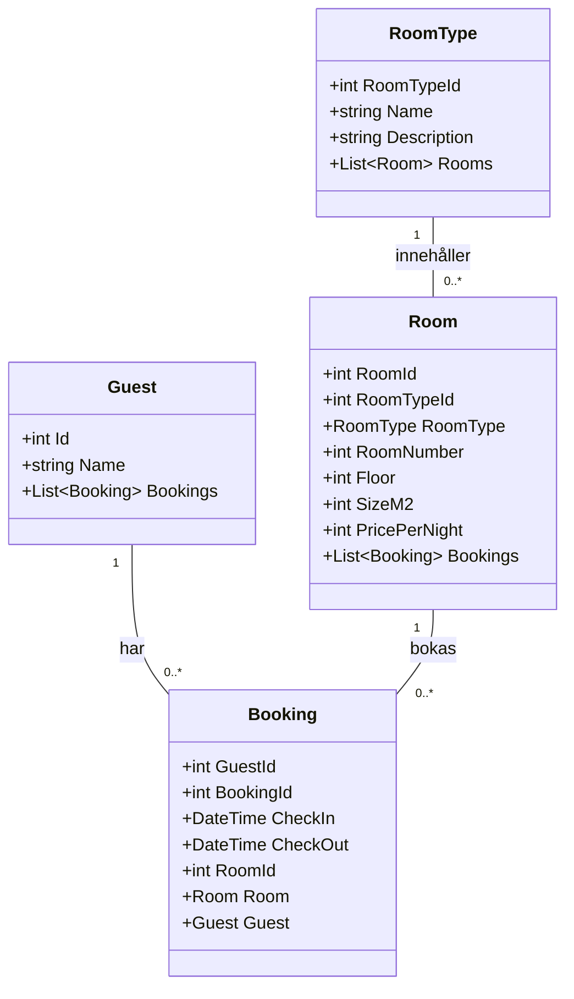

# Hotel Grandioso — Inlämning 1

**Namn:** Max Svensson

## Så kör du projektet

1. Forka repot på GitHub och klona din fork
2. Öppna `HotelGrandioso.slnx` i Visual Studio (eller öppna mappen i VS Code)
3. Tryck **F5** för att starta

Via terminalen:

```bash
dotnet run --project HotelGrandioso
```

## Databas

- **Databas:** SQLite
- **Databasfil:** `HotelGrandioso.db`
- **Migration:** `20261120101959_Init`
- **Skapa ny migration vid framtida ändring i modellerna:**
  `dotnet ef migrations add <MigrationensNamn> --project HotelGrandioso`
- **Applicera migrationer:**
  `dotnet ef database update --project HotelGrandioso`

## UML-klassdiagram



## GDPR

Utvärdera fälten i `Guest` ett i taget. Vad bygger du in, och varför?

>jag använder mig av fälten Id för att kunna referera till en gäst. tex. Anna Svensson får Id 1 och Karl Karlsson får Id 2 m.m.
> Name för att veta vem som har bokat så man får information från gästens id.
> 
> jag tog inte med hårfärg, längd eller religon då det inte spelar någon roll.
> det bryter mot gdpr att spara känslig information.
>
> Bookings är en lista som innehåller alla bokningar som hör till en gäst.
> På så sätt kan en gäst ha flera bokningar, och kopplingen sker via GuestId
> i Booking.
>

## Designmönster

>Jag har använt Repository-mönstret i HotelRepository.
> Klassen samlar metoder för att hämta, lägga till och ta bort bokningar samt räkna ut pris.
> Den använder HotelContext för åtkomst till databasen.

>Mönstret valdes för att separera databasanrop från övrig kod, vilket gör koden lättare att förstå och underhålla.

## Tekniker

- C# / .NET 11
- Entity Framework Core
